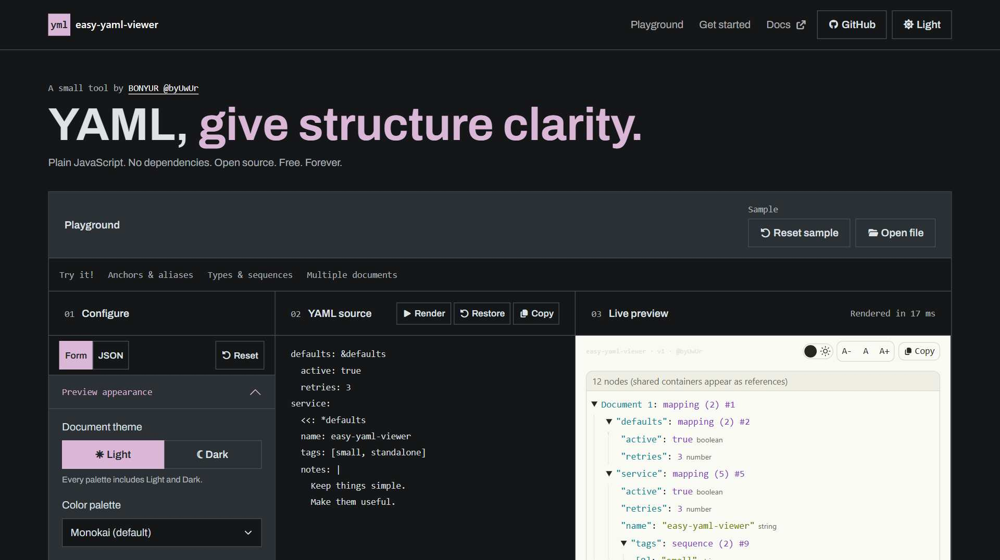

# YAML.view

Explore mappings, sequences, scalar values, and aliases as a collapsible tree. Complex keys and shared or cyclic aliases keep their meaning.



## Index

1. [Quick start](#quick-start)
2. [Try it](#try-it)
3. [Downloads](#downloads)
4. [API and options](#api-and-options)
5. [Themes](#themes)
6. [Checks and releases](#checks-and-releases)
7. [Related projects](#related-projects)
8. [License](#license)

## Quick start

```html
<link href="https://cdn.jsdelivr.net/gh/byuwur/yaml.view@latest/yaml.min.css" rel="stylesheet" />
<script src="https://cdn.jsdelivr.net/gh/byuwur/yaml.view@latest/yaml.min.js" defer></script>
<div id="viewer" data-theme="light"></div>
<script>
  document.addEventListener("DOMContentLoaded", () => {
    byYAMLviewer(document.getElementById("viewer"), "name: Andres\nactive: true\nroles: [developer, maintainer]");
  });
</script>
```

Pin a published tag in place of `@latest` for a fixed version.

### Offline use and Content Security Policy

The YAML parser is bundled in `yaml.js`; no separate parser script or network lookup is required. Local library files work without a CDN, including in a `file://` host. Host optional `yaml.themes.css` locally for extra palettes. The online playground and exported CDN starter still require internet access; a local starter requires all referenced files beside it. Playground fetches and clipboard permissions remain subject to browser restrictions.

Allow the script and style origins in your CSP. Authorize inline initialization and custom theme CSS separately, or move them into local files. The controls use static HTML templates and do not support enforced Trusted Types.

## Try it

[Playground](https://yaml.byuwur.co/)

Open [index.html](index.html) locally. Its host assets use the network. Exported starters use the default settings. The playground accepts local files up to 3 MiB.

## Downloads

[ZIP](https://github.com/byuwur/yaml.view/releases/latest/download/yaml.view.zip) · [Minified ZIP](https://github.com/byuwur/yaml.view/releases/latest/download/yaml.view.minified.zip)

## API and options

1. [Parser trade-off](#parser-trade-off)
2. [API and YAML behavior](#api-and-yaml-behavior)
3. [YAML options and limits](#yaml-options-and-limits)
4. [Maintaining the embedded parser](#maintaining-the-embedded-parser)
5. [Shared controls and lifecycle](#shared-controls-and-lifecycle)

### Parser trade-off

`yaml.js` bundles unmodified [js-yaml 5.4.3](https://github.com/nodeca/js-yaml/releases/tag/5.4.3) in a private closure, including its MIT license. This makes it larger than the other viewers, but needs no extra scripts or global `jsyaml`.

Check the parser version with `byYAMLviewer.PARSER_VERSION`.

Uses YAML 1.2 CORE plus merge keys and real JavaScript Maps (`CORE_SCHEMA.withTags(realMapTag, mergeTag)`), preserving complex keys. See [upstream usage](https://github.com/nodeca/js-yaml/blob/5.4.3/docs/usage.md) and [security considerations](https://github.com/nodeca/js-yaml/blob/5.4.3/docs/safety.md).

### API and YAML behavior

`byYAMLviewer(element, yaml?, options?)` accepts text; omitted input uses the target's text. Empty/comment-only streams display an empty state. Invalid input displays a parser error and resolves `ready` false.

`byYAMLviewer.parse(yaml)` synchronously returns an array of document values. Mappings are native `Map` objects, sequences are arrays, and scalars use core-schema string/number/boolean/null values. Multiple `---` documents, anchors, aliases, merge keys, block/folded scalars, flow collections, and explicit core tags are supported. Repeated object aliases retain identity, including cycles. Unknown/custom tags and duplicate mapping keys are rejected. Thrown errors include parser errors, `TypeError`, and `RangeError`.

Timestamps remain strings. Numbers use JavaScript precision; quote large integers to preserve every digit. YAML 1.1 binary, ordered-map, and set tags are disabled. The tree omits comments, anchor names, quote styles, and source formatting.

Main Copy always preserves the complete original source.

Containers get viewer-local display references such as `#1`. Shared/cyclic containers appear as `reference #1` without repeated expansion. Scalar aliases display their resolved values. Complex mapping keys have an Entry disclosure with separate Key and Value children.

Copy value returns exact string contents, YAML scalar spelling, or serialized container YAML with generated anchors as needed. Viewer labels are excluded.

Search matches displayed keys/scalars/types/references and expands ancestor paths; aliases are searched at their first expanded occurrence rather than recursively materializing them.

### YAML options and limits

| Option        | Default | Behavior                                                                      |
| ------------- | ------- | ----------------------------------------------------------------------------- |
| `collapsible` | `true`  | Show disclosure controls; false keeps every node expanded.                    |
| `collapsed`   | `false` | Initially close collection disclosures.                                       |
| `search`      | `false` | Case-insensitive substring search. Clearing restores initial collapse policy. |
| `copyValues`  | `false` | Show value copy buttons.                                                      |

Expand/collapse affects displayed collections only. Limits: 1 million source characters, depth 100, 1,000 aliases per document, 10,000 total processed merge keys, 100 documents, and 50,000 displayed graph records. Shared containers are indexed once; parser-specific limits may reject input sooner.

Parsing/indexing are synchronous; DOM creation yields every 100 nodes and search every 1,000 records. Closed branches retain their DOM descendants.

### Maintaining the embedded parser

The private `YAMLparser` block comes verbatim from `js-yaml@5.4.3/dist/js-yaml.cjs.js`, with the upstream license in its preceding comment. Treat it as vendor code: replace the whole block from a reviewed release, update `PARSER_VERSION` and version references, then run the viewer tests. Do not hand-edit or minify it. The upstream source-map reference is retained; the optional map is not shipped.

### Shared controls and lifecycle

| Option             | Default     | Behavior                                                                                                                                                   |
| ------------------ | ----------- | ---------------------------------------------------------------------------------------------------------------------------------------------------------- |
| `animations`       | `true`      | Brief control/disclosure motion and background fades; overrides the system motion preference.                                                              |
| `appearAnimation`  | `false`     | Fade the viewer in on each render when `animations` is enabled. Initial rendering remains immediate by default.                                            |
| `toolbar`          | `true`      | Show the viewer header; secondary tools are configured separately.                                                                                         |
| `credits`          | `true`      | Show attribution in the header.                                                                                                                            |
| `displayContainer` | `true`      | Show the content panel frame and inner horizontal padding. `false` also hides status information.                                                          |
| `statusBar`        | `true`      | Show counts and metadata when `displayContainer` is true. With `statusBar: false`, loading and empty results remain visible; errors always remain visible. |
| `expandCollapse`   | `false`     | Show Expand all / Collapse all.                                                                                                                            |
| `theme`            | Container   | Initial `"light"` or `"dark"` mode class.                                                                                                                  |
| `palette`          | Container   | Initial `data-theme` palette, including custom CSS names.                                                                                                  |
| `fontSize`         | Container   | Number in rem or a CSS size such as `"1.25em"` or `"20px"`; bounded to `0.5rem`-`3rem`.                                                                    |
| `themeToggle`      | `true`      | Show the theme toggle.                                                                                                                                     |
| `fontSizeControls` | `true`      | Show text-size controls.                                                                                                                                   |
| `copyButton`       | `true`      | Show full source copy button.                                                                                                                              |
| `controlsSize`     | `"regular"` | `"xs"` (0.5rem), `"small"` (0.7rem), `"regular"` (0.875rem), `"large"` (1rem), or `"xl"` (1.25rem); invalid values use `"regular"`.                        |
| `controlsCompact`  | `true`      | Keep credits beside controls; `false` stacks them. Wraps as needed.                                                                                        |
| `controlsPosition` | `"top"`     | Sticky `"top"` or `"bottom"` toolbar; invalid values use `"top"`.                                                                                          |

The controller exposes `ready` and `destroy()`. `ready` resolves `true` after initial rendering, or `false` on a displayed data error or cancellation. Invalid targets/options can throw synchronously.

`ready` describes the initial render only; it does not track later searches or disclosure changes.

```javascript
const viewer = byYAMLviewer(target, yaml, { search: true });
const rendered = await viewer.ready; // false on data errors or cancellation.
viewer.destroy(); // Call when the host panel is removed.
```

Re-rendering disposes the previous instance. `destroy()` cancels pending work and clears the target only if the instance still owns it. Duplicate script loads preserve the API. Read its version with `byYAMLviewer.VERSION`.

Input is displayed as text, never executed. Style `.byYAMLdocument` with `--by-view-bg`, `--by-view-text`, `--by-view-muted`, `--by-view-border`, `--by-view-accent`, `--by-view-alt`, `--by-view-string`, and `--by-view-literal`. The container uses system-ui; source/tree content uses monospace. Override the class or target's inline font/size as needed.

Copy requires clipboard permission in a secure context.

Requires a modern browser with async functions, WeakMap, ES2022 array methods, and CSS variables. The browser suites can run in Chromium, Firefox, and WebKit (see Checks).

`--by-view-content-font` and `--by-view-line-height` set source/tree typography.

The playground disables header-only settings while Viewer header is off, preserving their values. Appearing animation is disabled while Animations is off.

Use `toolbar: false` to hide the header, or disable `credits`, `themeToggle`, `fontSizeControls`, and `copyButton` individually. Content actions such as search and format-specific buttons use their own options.

Controls use monospace by default; override `--by-view-controls-font` to change it.

## Themes

Use `theme` for light or dark mode and `palette` for the color scheme. Monokai, GitHub, Solarized and High Contrast are built in. Load [yaml.themes.css](yaml.themes.css) after the base stylesheet for the other palettes.

Options override container settings. Omit an option or pass `null` to keep its current value. Numeric `fontSize` uses rem. CSS sizes such as `20px` also work within the `0.5rem` to `3rem` range. Invalid appearance values throw `RangeError` before replacing the document.

```html
<div id="viewer" class="dark" data-theme="github"></div>
```

Use **Copy CSS** in the playground to export appearance settings. Set `--by-view-document-bg` for the outer background and `--by-view-container-bg` for panels and controls. Define custom palette variables on the component’s mode class and `[data-theme]` selector. For example:

```css
.byYAMLdocument.dark[data-theme="my-ocean"] {
  --by-view-bg: #102a43;
  --by-view-text: #f0f6fc;
}
```

### Palette names

`monokai`, `github`, `solarized`, `high-contrast`, `dracula`, `darcula`, `nord`, `catppuccin`, `catppuccin-frappe`, `catppuccin-macchiato`, `rose-pine`, `rose-pine-moon`, `gruvbox`, `gruvbox-material`, `tokyo-night`, `tokyo-storm`, `tokyo-moon`, `one`, `material`, `material-ocean`, `night-owl`, `synthwave`, `ayu`, `everforest`, `kanagawa`, `selenized`, `vscode`, `monokai-dimmed`, `discord`, `slack`, `bonyur`, `sakura`, `bubblegum`, `candy`, `rose-gold`, `lavender`, `cyberpunk`, `sunset`, `volcano`, `amber`, `terminal`, `paper`, `ink`, `ocean`, `forest`, `mint`, `ice`, `sepia`.

High Contrast text colors target at least [7:1 contrast](https://www.w3.org/WAI/WCAG22/Understanding/contrast-enhanced.html), with [3:1 contrast for control boundaries and focus cues](https://www.w3.org/WAI/WCAG22/Understanding/non-text-contrast.html). Check contrast again when you override colors.

Legacy integrations can use `#byVIEWtheme` or a detected `yaml.light.css` / `yaml.dark.css` link. The toggle keeps its path, query, and hash and updates viewers sharing the link. Explicit container themes stay independent. Separate theme files are no longer shipped; retain your hosted legacy files to use this alternative.

## Checks and releases

Use Node.js 22+ and run these commands from the repository root. For playground checks, place sibling checkouts of `spa.js` at `v20.13`, `code.view` at `v2` next to this repository.

```sh
npm --prefix .github ci --ignore-scripts --no-audit --no-fund
node .github/node_modules/playwright/cli.js install chromium
export NODE_PATH="$PWD/.github/node_modules"
node --test --test-concurrency=1 __tests__/rendering.cjs __tests__/playground.cjs
node .github/scripts/build.mjs --tag v0.0.0-local
npm --prefix .github run release:test
```

In PowerShell, replace the `export` line with `$env:NODE_PATH = "$PWD/.github/node_modules"`. [CI](.github/workflows/rendering.yml) runs Chromium automatically; choose Firefox or WebKit on a manual run.

The [release workflow](.github/workflows/release.yml) tests the regular and minified ZIPs. Both contain the runtime files, README and license. The build manifest records the version and source commit. The local build writes `dist/assets/` and `dist/RELEASE_NOTES.md`. Use `--offline` for local minification. Publish by pushing a version tag matching the library’s `VERSION` (for example, `v2` for version 2).

## Related projects

[CODE.view](https://github.com/byuwur/code.view) · [CSV.view](https://github.com/byuwur/csv.view) · [DIFF.view](https://github.com/byuwur/diff.view) · [JSON.view](https://github.com/byuwur/json.view) · [LOG.view](https://github.com/byuwur/log.view) · [MD.edit](https://github.com/byuwur/md.edit) · [MD.view](https://github.com/byuwur/md.view) · [XML.view](https://github.com/byuwur/xml.view)

## License

MIT (c) 2026 Andres Trujillo [Mateus] byUwUr. See [LICENSE](LICENSE.md).
