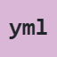

# byuwur/easy-yaml-viewer


**YAML, give structure clarity.**

Explore mappings, sequences, scalar values, and aliases as a collapsible tree. Complex keys and shared or cyclic aliases keep their meaning.

Use it for configuration files, manifests, and YAML documents with more structure than a wall of text can show.

One JavaScript file. One scoped stylesheet. No build step. The YAML parser is bundled; there is nothing extra to load.

<!-- [Open the playground](https://byuwur.github.io/easy-yaml-viewer/) -->

[Open the playground](https://yaml.byuwur.co/)

Open `index.html` for the local playground; its page assets require internet access.

## Parser trade-off

`yaml.js` bundles unmodified [js-yaml 5.4.3](https://github.com/nodeca/js-yaml/releases/tag/5.4.3) in a private closure, including its MIT license. This makes it larger than the other viewers, but needs no extra scripts or global `jsyaml`.

This is the only bundled dependency. Read its version with `byYAMLviewer.PARSER_VERSION`.

Uses YAML 1.2 CORE plus merge keys and real JavaScript Maps (`CORE_SCHEMA.withTags(realMapTag, mergeTag)`), preserving complex keys. See [upstream usage](https://github.com/nodeca/js-yaml/blob/5.4.3/docs/usage.md) and [security considerations](https://github.com/nodeca/js-yaml/blob/5.4.3/docs/safety.md).

## Installation and usage

**Recommended: CDN.** No downloads or package manager.

```html
<link href="https://cdn.jsdelivr.net/gh/byuwur/easy-yaml-viewer@latest/yaml.min.css" rel="stylesheet" />
<script src="https://cdn.jsdelivr.net/gh/byuwur/easy-yaml-viewer@latest/yaml.min.js" defer></script>
<div id="viewer" data-theme="light"></div>
<script>
  document.addEventListener("DOMContentLoaded", () => {
    byYAMLviewer(document.getElementById("viewer"), "name: Andres\nactive: true\nroles: [developer, maintainer]");
  });
</script>
```

The CDN example uses `@latest` and requires internet access. Use a published tag or commit to pin a version.

**Local files:** For offline use, save `yaml.js` and `yaml.css` beside your HTML:

```html
<link href="yaml.css" rel="stylesheet" />
<script src="yaml.js" defer></script>
```

Exported HTML starters use default settings, independently of playground changes.

## Offline use and Content Security Policy

The YAML parser is bundled in `yaml.js`; no separate parser script or network lookup is required. Local library files work without a CDN, including in a `file://` host. Host optional `yaml.themes.css` locally for extra palettes. The online playground and exported CDN starter still require internet access; a local starter requires all referenced files beside it. Playground fetches and clipboard permissions remain subject to browser restrictions.

For CSP, allow library origins in `script-src` and `style-src`. Move example inline initialization into an allowed external script, or authorize it with a nonce/hash; no `unsafe-eval` is needed. Appearance controls write individual style properties; host-authored inline style attributes and custom theme `<style>` blocks need their own policy authorization. A script nonce does not authorize those styles. Control templates use `innerHTML` for static markup and do not currently support enforced Trusted Types (`require-trusted-types-for 'script'`). The playground uses additional CDN assets, inline scripts/styles, and generated previews, so its policy requirements exceed those of the standalone library.

## API and YAML behavior

`byYAMLviewer(element, yaml?, options?)` accepts text; omitted input uses the target's text. Empty/comment-only streams display an empty state. Invalid input displays a parser error and resolves `ready` false.

`byYAMLviewer.parse(yaml)` synchronously returns an array of document values. Mappings are native `Map` objects, sequences are arrays, and scalars use core-schema string/number/boolean/null values. Multiple `---` documents, anchors, aliases, merge keys, block/folded scalars, flow collections, and explicit core tags are supported. Repeated object aliases retain identity, including cycles. Unknown/custom tags and duplicate mapping keys are rejected. Thrown errors include parser errors, `TypeError`, and `RangeError`.

Timestamps remain strings. Numbers use JavaScript precision; quote large integers to preserve every digit. YAML 1.1 binary, ordered-map, and set tags are disabled. The tree omits comments, anchor names, quote styles, and source formatting.

Main Copy always preserves the complete original source.

Containers get viewer-local display references such as `#1`. Shared/cyclic containers appear as `reference #1` without repeated expansion. Scalar aliases display their resolved values. Complex mapping keys have an Entry disclosure with separate Key and Value children.

Copy value returns exact string contents, YAML scalar spelling, or serialized container YAML with generated anchors as needed. Viewer labels are excluded.

Search matches displayed keys/scalars/types/references and expands ancestor paths; aliases are searched at their first expanded occurrence rather than recursively materializing them.

## YAML options and limits

| Option        | Default | Behavior                                                                      |
| ------------- | ------- | ----------------------------------------------------------------------------- |
| `collapsible` | `true`  | Show disclosure controls; false keeps every node expanded.                    |
| `collapsed`   | `false` | Initially close collection disclosures.                                       |
| `search`      | `false` | Case-insensitive substring search. Clearing restores initial collapse policy. |
| `copyValues`  | `false` | Show value copy buttons.                                                      |

Expand/collapse affects displayed collections only. Limits: 1 million source characters, depth 100, 1,000 aliases per document, 10,000 total processed merge keys, 100 documents, and 50,000 displayed graph records. Shared containers are indexed once; parser-specific limits may reject input sooner.

Parsing/indexing are synchronous; DOM creation yields every 100 nodes and search every 1,000 records. Closed branches retain their DOM descendants.

## Maintaining the embedded parser

The private `YAMLparser` block comes verbatim from `js-yaml@5.4.3/dist/js-yaml.cjs.js`, with the upstream license in its preceding comment. Treat it as vendor code: replace the whole block from a reviewed release, update `PARSER_VERSION` and version references, then run the viewer tests. Do not hand-edit or minify it. The upstream source-map reference is retained; the optional map is not shipped.

## Shared controls and lifecycle

| Option             | Default     | Behavior                                                                                                                                                   |
| ------------------ | ----------- | ---------------------------------------------------------------------------------------------------------------------------------------------------------- |
| `animations`       | `true`      | Brief control/disclosure motion and background fades; overrides the system motion preference.                                                              |
| `appearAnimation`  | `false`     | Fade and gently move the viewer in when `animations` is enabled. Initial rendering remains immediate by default.                                           |
| `toolbar`          | `true`      | Show the viewer header; secondary tools are configured separately.                                                                                         |
| `credits`          | `true`      | Show attribution in the header.                                                                                                                            |
| `displayContainer` | `true`      | Show the content panel frame and inner horizontal padding. `false` also hides status information.                                                          |
| `statusBar`        | `true`      | Show counts and metadata when `displayContainer` is true. With `statusBar: false`, loading and empty results remain visible; errors always remain visible. |
| `expandCollapse`   | `false`     | Show Expand all / Collapse all.                                                                                                                            |
| `theme`            | Container   | Initial `"light"` or `"dark"` mode class.                                                                                                                  |
| `palette`          | Container   | Initial `data-theme` palette, including custom CSS names.                                                                                                  |
| `fontSize`         | Container   | Number in rem or a CSS size such as `"1.25em"` or `"20px"`; bounded to `0.5rem`–`3rem`.                                                                    |
| `themeToggle`      | `true`      | Show the theme toggle.                                                                                                                                     |
| `fontSizeControls` | `true`      | Show text-size controls.                                                                                                                                   |
| `copyButton`       | `true`      | Show full source copy button.                                                                                                                              |
| `controlsSize`     | `"regular"` | `"xs"` (0.5rem), `"small"` (0.7rem), `"regular"` (0.875rem), `"large"` (1rem), or `"xl"` (1.25rem); invalid values use `"regular"`.                        |
| `controlsCompact`  | `true`      | Keep credits beside controls; `false` stacks them. Wraps as needed.                                                                                        |
| `controlsPosition` | `"top"`     | Sticky `"top"` or `"bottom"` toolbar; invalid values use `"top"`.                                                                                          |

The controller exposes `ready` and `destroy()`. `ready` resolves `true` after initial rendering, or `false` on a displayed data error or cancellation. Invalid targets/options can throw synchronously.

`ready` describes the initial render only; it does not track later searches or disclosure changes.

```javascript
const viewer = byYAMLviewer(target, yaml, { search: true });
const rendered = await viewer.ready; // false on data errors or cancellation.
viewer.destroy(); // Call when the host panel is removed.
```

Re-rendering disposes the previous instance. `destroy()` cancels pending work and clears the target only if the instance still owns it. Duplicate script loads preserve the API. Read its version with `byYAMLviewer.VERSION`.

Input is displayed as text, never executed. Style `.byYAMLdocument` with `--by-view-bg`, `--by-view-text`, `--by-view-muted`, `--by-view-border`, `--by-view-accent`, `--by-view-alt`, `--by-view-string`, and `--by-view-literal`. The container uses system-ui; source/tree content uses monospace. Override the class or target's inline font/size as needed.

Copy requires clipboard permission in a secure context.

Requires a modern browser with async functions, WeakMap, ES2022 array methods, and CSS variables. The browser suites can run in Chromium, Firefox, and WebKit (see Checks).

`--by-view-content-font` and `--by-view-line-height` set source/tree typography.

The playground disables header-only settings while Viewer header is off, preserving their values. Appearing animation is disabled while Animations is off.

Use `toolbar: false` to hide the header, or disable `credits`, `themeToggle`, `fontSizeControls`, and `copyButton` individually. Content actions such as search and format-specific buttons use their own options.

Controls use monospace by default; override `--by-view-controls-font` to change it.

## Themes

Configure appearance in the options object or on the container:

```javascript
byYAMLviewer(target, source, {
  theme: "dark",
  palette: "github",
  fontSize: 1.125
});
```

`theme` sets the mode class; `palette` sets `data-theme`. `fontSize` numbers use rem (`1` = the root text size); CSS sizes such as `"1.25em"`, `"1.25rem"`, and `"20px"` are also accepted. All sizes stay between `0.5rem` and `3rem`. Explicit options override markup; omitted or `null` values retain the container's settings. A named palette preserves its existing mode, including the `data-theme="light"` / `"dark"` aliases. Invalid appearance values throw `RangeError` before replacing the current document. Text-size Reset returns to the configured size, including after re-rendering.

Initial content appears immediately unless `appearAnimation: true` is requested with animations enabled. Theme backgrounds fade briefly on shared surfaces; font size, rows, and syntax tokens change immediately. High Contrast and forced-color backgrounds switch immediately. Animations also affect controls and deliberate show/hide actions. Disclosure size/exit transitions progressively enhance browsers that support them.

The outer document and inner surfaces have independent CSS backgrounds. Both follow the selected theme unless overridden. Set `--by-view-document-bg: #0000` to reveal the host page while keeping content panels and individual controls readable. `--by-view-container-bg` sets the shared background of those panels and controls; it also accepts alpha colors or `transparent`. The toolbar and credits have no background. These overrides survive theme changes.

```css
.byYAMLdocument {
  --by-view-document-bg: #0000;
}
```

The playground uses SPA.js's Pickr assets for color and opacity, with text inputs when Pickr is unavailable. **Copy CSS** exports the appearance overrides; clear a field to restore its theme default. The renderer needs no color-picker dependency.

**48 palettes, each with Light and Dark modes.** Monokai, GitHub, Solarized, and High Contrast are included in `yaml.css`. Load the optional `yaml.themes.css` after it for the other 44 skins:

```html
<link rel="stylesheet" href="https://cdn.jsdelivr.net/gh/byuwur/easy-yaml-viewer@latest/yaml.themes.min.css" />
```

For local use, save `yaml.themes.css` beside `yaml.css`. The playground loads both stylesheets; default HTML starters use the core stylesheet. Known extra presets without the pack fall back to the current mode and emit a one-time `console.warn` naming the required file. Custom CSS names do not need the pack.

The picker groups palettes into Essentials, Editor classics, App inspired, Colorful, and Reading & nature. Palette definitions remain at the end of each stylesheet.

| Palette              | `data-theme`           | What it looks like                             |
| -------------------- | ---------------------- | ---------------------------------------------- |
| Monokai (default)    | `monokai`              | Warm light and dark colors; the default.       |
| GitHub               | `github`               | Neutral GitHub surfaces and syntax.            |
| Solarized            | `solarized`            | Warm paper and deep blue-green surfaces.       |
| High Contrast        | `high-contrast`        | Strong text, borders, and focus indicators.    |
| Dracula              | `dracula`              | Purple with vivid pink, green, and cyan.       |
| Darcula              | `darcula`              | Charcoal surfaces and warm IDE accents.        |
| Nord                 | `nord`                 | Arctic blues and snowy neutral surfaces.       |
| Catppuccin           | `catppuccin`           | Latte and Mocha with soft mauve accents.       |
| Catppuccin Frappé    | `catppuccin-frappe`    | Cooler Catppuccin with a blue accent.          |
| Catppuccin Macchiato | `catppuccin-macchiato` | Catppuccin with a warm pink accent.            |
| Rosé Pine            | `rose-pine`            | Dawn and Pine with dusty rose accents.         |
| Rosé Pine Moon       | `rose-pine-moon`       | A duskier violet take on Rosé Pine.            |
| Gruvbox              | `gruvbox`              | Warm retro browns, olive, and orange.          |
| Gruvbox Material     | `gruvbox-material`     | Softer earthy surfaces and muted greens.       |
| Tokyo Night          | `tokyo-night`          | Tokyo Day and Night with electric blues.       |
| Tokyo Storm          | `tokyo-storm`          | A brighter blue-gray Tokyo evening.            |
| Tokyo Moon           | `tokyo-moon`           | Indigo nights and luminous lavender.           |
| One                  | `one`                  | Clean One Light and One Dark colors.           |
| Material             | `material`             | Blue-gray material surfaces and cyan.          |
| Material Ocean       | `material-ocean`       | Deep navy with soft fluorescent accents.       |
| Night Owl            | `night-owl`            | Little Light and deep-blue night colors.       |
| Synthwave            | `synthwave`            | Neon magenta and cyan with no glow effects.    |
| Ayu                  | `ayu`                  | Warm amber over light paper or dark navy.      |
| Everforest           | `everforest`           | Soft forest greens and cream.                  |
| Kanagawa             | `kanagawa`             | Ink, old paper, and Japanese wave colors.      |
| Selenized            | `selenized`            | Balanced teal surfaces and restrained color.   |
| VS Code              | `vscode`               | Familiar neutral editor surfaces and blue.     |
| Monokai Dimmed       | `monokai-dimmed`       | Quieter charcoal and desaturated Monokai.      |
| Discord              | `discord`              | Blurple accents and familiar chat surfaces.    |
| Slack                | `slack`                | Aubergine, warm pink, and friendly teal.       |
| BONYUR               | `bonyur`               | Signature teal and pink over warm neutral ink. |
| Sakura               | `sakura`               | Cherry-blossom pink from surface to syntax.    |
| Bubblegum            | `bubblegum`            | Saturated hot-pink surfaces and cyan accents.  |
| Candy                | `candy`                | Pink and mint with playful lavender syntax.    |
| Rose Gold            | `rose-gold`            | Dusty pink and warm copper.                    |
| Lavender             | `lavender`             | Lilac surfaces with deep violet accents.       |
| Cyberpunk            | `cyberpunk`            | Acid yellow, electric cyan, and magenta.       |
| Sunset               | `sunset`               | Burnt orange, coral, and evening purple.       |
| Volcano              | `volcano`              | Lava reds over warm ash.                       |
| Amber                | `amber`                | Golden amber inspired by old displays.         |
| Terminal             | `terminal`             | Phosphor greens on near-black.                 |
| Paper                | `paper`                | Warm cream, brown ink, and quiet margins.      |
| Ink                  | `ink`                  | Grayscale surfaces and restrained syntax.      |
| Ocean                | `ocean`                | Deep ocean blue and clear turquoise.           |
| Forest               | `forest`               | Rich green surfaces and mossy accents.         |
| Mint                 | `mint`                 | Fresh mint surfaces and cool teal.             |
| Ice                  | `ice`                  | Glacial blue, crisp whites, and silver.        |
| Sepia                | `sepia`                | Aged parchment and warm brown ink.             |

Editor and app skins are inspired adaptations, including light counterparts where needed; colors are adjusted for readable text and controls rather than exact replicas. All palettes use the same layout and need no assets beyond the core stylesheet and optional theme pack.

Use a mode class and a palette name together:

```html
<div id="viewer" class="dark" data-theme="github"></div>
<!-- High Contrast Light: class="light" data-theme="high-contrast" -->
<!-- High Contrast Dark: class="dark" data-theme="high-contrast" -->
```

Rendering adds `.byYAMLdocument`; its variables affect only that container and its children. The theme switch changes mode while keeping the palette; re-rendering preserves both. A named palette without a mode class starts in Light; if both mode classes are present, Dark wins.

`data-theme="light"` and `data-theme="dark"` select Monokai and override mode classes. A mode class alone, or no explicit theme, also uses Monokai.

### High Contrast

High Contrast text colors target at least [7:1 contrast](https://www.w3.org/WAI/WCAG22/Understanding/contrast-enhanced.html), with [3:1 contrast for control boundaries and focus cues](https://www.w3.org/WAI/WCAG22/Understanding/non-text-contrast.html). Check contrast again when you override colors.

### Make it yours

The playground's **Custom theme CSS** field edits both modes of the selected palette. Export those rules to your own stylesheet and use `data-theme="custom"` with `class="light"` or `class="dark"`. Custom drafts stay in the playground; the renderer does not store them.

Define a named palette after the viewer stylesheet. Unspecified colors inherit Monokai:

```css
.byYAMLdocument.light[data-theme="my-ocean"] {
  --by-view-bg: #f3f8fc;
  --by-view-text: #102a43;
  --by-view-border: #486581;
  --by-view-accent: #005a9c;
}

.byYAMLdocument.dark[data-theme="my-ocean"] {
  --by-view-bg: #102a43;
  --by-view-text: #f0f6fc;
  --by-view-border: #9fb3c8;
  --by-view-accent: #8cd3ff;
}
```

```html
<div id="viewer" class="dark" data-theme="my-ocean"></div>
```

Named palettes need no JavaScript registration or extra theme files.

In the playground configuration, `theme` is the mode, `palette` is its name, and `customThemeCSS` holds custom rules. Null appearance values inherit defaults. Pass only documented API options to the renderer.

**Copy CSS** exports typography and individual color overrides. Inline colors override palette variables; clear them or Reset to restore palette defaults.

Text-size controls change only this viewer, in `0.125rem` steps from `0.5rem` to `3rem`, independently of button size. **A** restores its initial size; re-rendering preserves the selected size.

### Legacy theme links

Legacy integrations can use `#byVIEWtheme` or a detected `yaml.light.css` / `yaml.dark.css` link. The toggle keeps its path, query, and hash and updates viewers sharing the link. Explicit container themes stay independent. Separate theme files are no longer shipped; retain your hosted legacy files to use this alternative.

## Checks

Theme tests cover both modes, container isolation, legacy links, custom CSS, and High Contrast. Clipboard tests use stubs; they do not verify real permissions.

Playground tests fetch the pinned Bootstrap stylesheet unless `BOOTSTRAP_CSS_PATH` points to a cached copy.

Install Playwright outside the repository and set `NODE_PATH` to its `node_modules` directory:

```sh
node --check yaml.js
node --test __tests__/rendering.cjs   # Library
node --test __tests__/playground.cjs  # Playground
```

Tests default to Playwright Chromium. Set `BROWSER_ENGINE=firefox` or `BROWSER_ENGINE=webkit` for the other engines. Install matching engines with `npx playwright install chromium firefox webkit` from your external Playwright setup. `BROWSER_CHANNEL=chrome` uses installed Chrome; `CHROMIUM_EXECUTABLE_PATH` selects a Chromium executable. These overrides apply only to Chromium. [GitHub Actions](.github/workflows/rendering.yml) reports Library and Playground as independent jobs; a failed suite does not cancel the other.

CI runs library and playground suites independently in Chromium, Firefox, and WebKit. Touch/mobile-width checks cover Chromium and WebKit emulation, with a narrow touch viewport in Firefox. WebKit is not certification of shipping Safari or iOS devices. Synthetic editor composition checks do not reproduce an OS IME. Real mobile keyboards, VoiceOver/NVDA, clipboard permissions, and device-specific rendering still require manual testing; automated checks are not a complete WCAG audit.

## The easy viewers

Need another format, maybe an editor? Explore the family:

<!-- <a href="https://byuwur.github.io/easy-md-viewer/"> MD</a> · <a href="https://byuwur.github.io/easy-md-editor/"> MD.edit</a> · <a href="https://byuwur.github.io/easy-code-viewer/"> CODE</a> · <a href="https://byuwur.github.io/easy-json-viewer/"> JSON</a> · <a href="https://byuwur.github.io/easy-csv-viewer/"> CSV</a> · <a href="https://byuwur.github.io/easy-diff-viewer/"> DIFF</a> · <a href="https://byuwur.github.io/easy-log-viewer/"> LOG</a> · <a href="https://byuwur.github.io/easy-xml-viewer/"> XML</a> · <a href="https://byuwur.github.io/easy-yaml-viewer/"> YAML</a> -->

<a href="https://md.byuwur.co/"> MD</a> · <a href="https://mdedit.byuwur.co/"> MD.edit</a> · <a href="https://code.byuwur.co/"> CODE</a> · <a href="https://json.byuwur.co/"> JSON</a> · <a href="https://csv.byuwur.co/"> CSV</a> · <a href="https://diff.byuwur.co/"> DIFF</a> · <a href="https://log.byuwur.co/"> LOG</a> · <a href="https://xml.byuwur.co/"> XML</a> · <a href="https://yaml.byuwur.co/"> YAML</a>

## License

MIT (c) 2026 Andres Trujillo [Mateus] byUwUr. See [LICENSE](LICENSE.md).

[](https://deepwiki.com/byuwur/easy-yaml-viewer)
